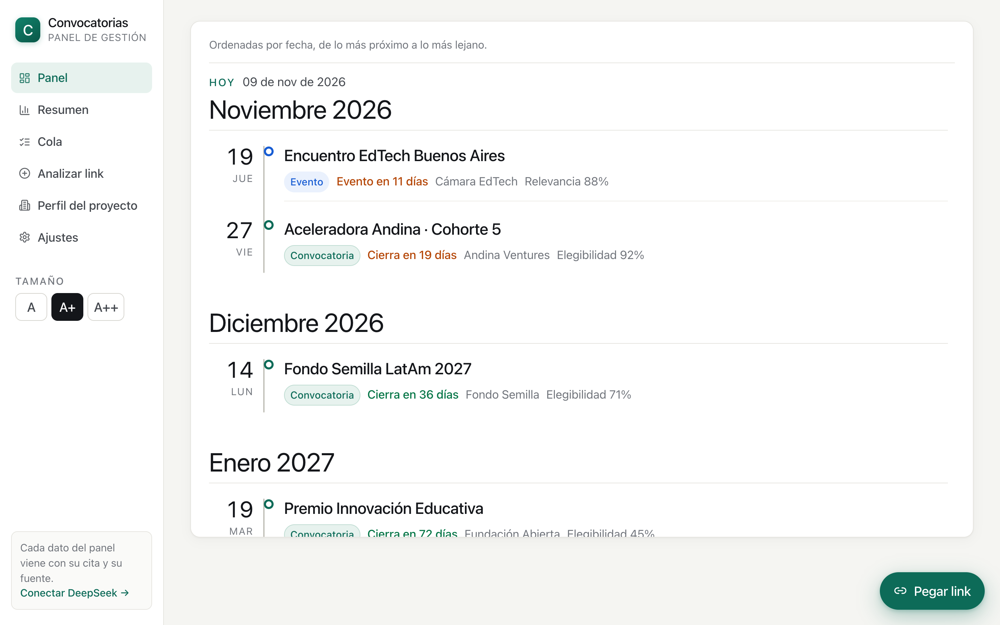
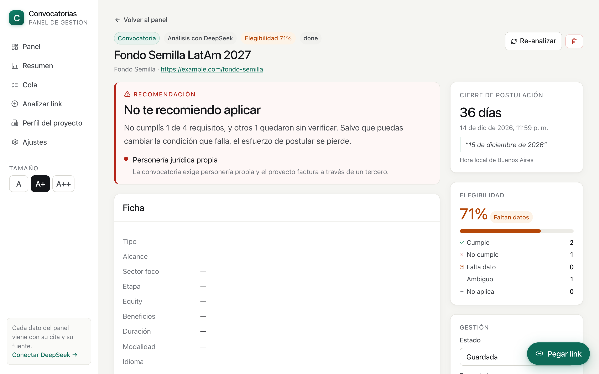

# Convocatorias

[](https://github.com/pestequiel-dev/asistente-convocatorias/actions/workflows/ci.yml)

**English** · [Español](README.es.md)

A local dashboard to manage grants, accelerators and startup awards. You paste a link (and optionally the text of
the LinkedIn/Instagram post) and the system:

1. crawls the site with a real browser,
2. finds the **terms and conditions**, the requirements and the **application form**,
3. extracts everything with **verbatim quotes and URLs**,
4. compares the requirements against the project profile,
5. detects the **closing date** and renders the dashboard.

The UI is in Spanish (Rioplatense) on purpose: the target users are founders applying to Latin American
programs. The code, the data model and this README are language-neutral, and this document is the English
reference for the project.

---

## Screenshots

Timeline panel (grouped by month):



Grant detail: per-criterion verdict with the quote from the source:



The screenshots use a sample profile and sample programs ("Proyecto de ejemplo"); there is no real data.

---

## Who it is for

For founders and small teams applying to many programs at once, who lose hours reading terms that turn out not
to apply. The use case is one person (or a team of two) keeping an application pipeline: what is open, what
closes soon, whether we are eligible and what is missing to become eligible.

It is not multi-user and not a SaaS: it runs on your machine, data stays in a local SQLite file, and nothing is
sent anywhere except the page text to the model you configure.

---

## Getting started

```bash
npm install
npm run dev
```

Open **http://localhost:3100**.

`npm run dev` starts two processes: the web app (Next.js) and the worker that drains the analysis queue.

On first run a **sample profile** ("Proyecto de ejemplo") is seeded so the dashboard has something to compare
against. Edit or delete it from **Perfil del proyecto**.

### Connect DeepSeek (recommended)

Without an API key the app still works, but in a **heuristic mode** (regex + rules): much less accurate.

1. Create a key at https://platform.deepseek.com/api_keys
2. Go to **Ajustes** in the app and paste it. It is stored only in `data/app.db`.

Approximate cost: **US$ 0.01–0.05 per program** (depends on how many pages and PDFs the site has).

You can also use environment variables: copy `.env.example` to `.env.local`.

### Browser

Crawling uses Playwright. If Chromium is not downloaded, the app automatically detects **Brave / Chrome /
Edge** installed on macOS. If you prefer Playwright's Chromium:

```bash
npx playwright install chromium
```

---

## Stack

- **Next.js 15** (App Router) + **React 19** + **TypeScript**, no UI framework.
- **SQLite** via `better-sqlite3` (WAL) in `data/app.db`: programs, sources, criteria, dates, profile, settings.
- **Playwright** (headless Chromium) to crawl real sites; **unpdf** to read PDFs.
- **DeepSeek API** (optional, OpenAI-compatible) for extraction, classification and matching; heuristics as a
  fallback across the whole pipeline.

---

## How it works

```
POST /api/programs (url + text)
        │
        ├─ resolveStartUrl()   if the link is from LinkedIn/Instagram, find the real link inside the pasted text
        │
        ├─ classify()          cheap HTTP preview (no browser) + LLM → grant | event | competitor | reference
        │                      this decides how much is crawled: 24 pages, 6, 6 or 2
        │
        ├─ crawlSite()         BFS with link scoring, headless Chromium, PDFs via unpdf
        │                      stores every page in `sources` (hash + text) as evidence
        │
        ├─ extract()           DeepSeek with response_format=json_object → fixed schema
        │                      fallback: extractHeuristic()
        │                      validateCitations() lowers confidence when a quote is not in the source
        │
        ├─ matchWithLlm()      criterion by criterion against the profile → meets / fails / missing / ambiguous
        │  └ matchHeuristic()  per-category rules when there is no LLM
        │
        └─ computeScore()      score 0–100 + overall verdict
```

### Early rejection

Before creating any record, a cheap check runs (HTTP preview + classification). The classifier returns two
separate things: the **type** (grant / event / competitor / reference) and the **relevance** to the project.

If the link **is not relevant**, a `422` with the reason is returned and nothing is created or crawled. Being a
"reference" is not enough to reject it: an investment fund's home page, a note about edtech or a teacher's
profile are useful context and are stored. What gets discarded is an unrelated industry (beverages, retail,
sports).

The modal offers "Guardar igual" to force the record (sends `force: true`), and manual entry from "Analizar
link" has the same button.

### Triage: not everything is a grant

`lib/classify.ts` decides **before** the deep crawl, using an HTTP preview and the pasted text. The crawl is the
expensive part; classification costs cents.

| Type | What is extracted | Question it answers |
|---|---|---|
| **grant** | terms, criteria, form, deadline | are we eligible? |
| **event** | date, venue, cost, audience, call for speakers, booths | is it worth going or exhibiting? |
| **competitor** | positioning, pricing, features, strengths/weaknesses | what do they do and how much do they charge? |
| **reference** | title + summary | archived, not analyzed |

Classified items go to the **inbox** and do not appear on the dashboard until you confirm the type. If you
change the type, it is re-analyzed with that type forced (`?kind=`), because the first analysis used the wrong
routing.

**Events**: besides the data, a `relevance_score` is computed (school audience, call for speakers, booths,
remote, country) to prioritize.

**Competitors**: every page is stored with a hash. On re-analysis a line diff against the previous snapshot is
computed and stored in `diff_summary` — useful to detect pricing or feature changes. The diff is deterministic
(no LLM), so it is free.

### Why every fact has a quote

A management dashboard is only useful if you trust it. Therefore:

- every criterion stores `quote` (verbatim text) and `source_url`;
- if the quote is not found in the source text, it is discarded and confidence drops;
- the detail page always shows the original text of the closing date;
- the evidence tab lists every page that was read.

### Eligibility

Criteria are classified into: `geografia`, `legal`, `etapa`, `sector`, `ingresos`, `equipo`, `producto`,
`idioma`, `otro`.

Verdicts: `cumple` (1), `falta_dato` (0.5), `ambiguo` (0.5), `no_cumple` (0). The overall verdict is
`not eligible` if any `no_cumple` exists, `needs info` if any field is uncovered, and `eligible` if everything
is met.

### Visual accessibility

The app is designed for reading with low vision:

- **No bold anywhere**: the maximum weight is 500 (titles, badges, buttons). There is no 600/700.
- **Global text size** control in the sidebar: **A** (×1.10 → 16 px body), **A+** (×1.25, default → 18 px) and
  **A++** (×1.45 → 21 px). It applies to the whole app, is stored in `localStorage` and applied before the first
  paint (no flash).
- No text falls below **16 px** at the maximum setting.
- All scaling uses `calc(Npx * var(--fs))`, so tables, badges, forms and the detail page grow too.
- **Visible keyboard focus** of 3 px, `prefers-reduced-motion` respected and AA contrast.
- Information never relies on color alone: there is always text ("Cierra en 7 días", "Ya pasó", "Falta dato").

### Timeline

The dashboard (`/`) is only the timeline, grouped by month:

- months at **37 px** at the default setting (no bold);
- future months come first in chronological order; past ones at the end labeled "ya pasó";
- items without a date are grouped at the end under "Sin fecha";
- it fills the screen and **only the inner container scrolls**, with sticky month headers.

## Batch analysis (400+ links)

The queue lives in SQLite, so it **survives restarts**: you can queue 400 links, close the laptop and come back
to find it where it left off.

- **Load**: `/cola` → paste the links (one per line or comma-separated). Duplicates and links already on the
  dashboard are dropped. Nothing is classified when queued: each link is evaluated when its turn comes.
- **Concurrency**: 1 to 4 analyses in parallel. Each opens its own Chromium (~250 MB). Start with 2.
- **Pause**: running analyses finish and no new one is taken. Resuming is instant.
- **Progress**: pending, processing, done, discarded, errors, average per link and ETA computed from the last
  20.
- **Automatic discard**: if classification says the link is unrelated to the business, it is marked `rejected`
  **without crawling a single page** (2 seconds instead of 2 minutes).
- **Recovery**: if the process dies mid-analysis, the worker re-queues it after 8 minutes.

Estimated time for 400 links with 2 in parallel and ~2 min per link: **~6.5 hours**. With 3: ~4.5 hours.

## Quick link paste

There is a floating **"Pegar link"** button always visible on any screen (or **⌘K / Ctrl+K**). When opened:

1. It reads the clipboard **only at that moment** (requires a user gesture; never in the background).
2. If it finds a URL — even mixed with text — it pastes it by itself.
3. The field plays a wobble animation as confirmation, disabled with `prefers-reduced-motion`.
4. Enter analyzes the link and takes you to the detail page.

The modal is glassmorphism (`backdrop-filter`) with a solid fallback if the browser does not support it:
legibility wins. It traps focus, has `aria-modal`, closes with Escape and returns focus to the button.

## Third-party legal structure

If the project has no legal entity of its own and operates under a cooperative or partner company, you choose
**"Opera bajo la estructura legal de un tercero"** and describe it in the detail field.
In that case, a "must be incorporated" requirement is **neither marked as met nor as failed**: it stays
`ambiguous`, with a note that you must confirm whether the cooperative can appear as applicant.
Invoicing/CUIT requirements are evaluated with the "¿Pueden emitir factura?" field.

### Project context documents

In **Perfil del proyecto → Documentos de contexto** you can paste links to a pitch deck, metrics, roadmap or
one-pager. When added, the server **reads the content** (Google Docs via `export?format=txt`, PDFs with `unpdf`,
plain HTML) and stores it.

That text becomes a source of truth in both prompts: when extracting grant requirements and when comparing
criterion by criterion. If a document answers a requirement, it stops being `falta_dato`.

Anything behind a login cannot be read: the document is still stored, marked as "sin contenido".

### Fixing a criterion without leaving the detail page

Every criterion that is not "met" has an **Aportar el dato** button (or *Aclarar* / *Corregir* depending on the
verdict). A text field opens inside the card: you write the real fact — "invoices through the cooperative", "the
team has two members" — and the AI re-evaluates **only that criterion** against the profile + your input,
recomputes the score and the program verdict, and updates the recommendation.

The input is stored in `criteria.user_note`, included in future re-evaluations and can be edited or removed.
Without an LLM configured the input is still recorded, but the verdict becomes "ambiguous" instead of pretending
it was interpreted.

**The profile is the main asset**: the more complete it is, the fewer `falta_dato`. It is edited in **Perfil del
proyecto** and the **Re-evaluar** button compares again without repeating the crawl (fast and cheap).

---

## Structure

```
app/
  page.tsx                  dashboard: timeline only
  resumen/                  counts, type inbox and management table
  nueva/                    link ingestion
  programa/[id]/            full detail page
  perfil/                   project profile
  ajustes/                  API key, model, limits
  api/programs/             create, detail, PATCH, re-analysis, re-evaluation, delete
  api/export/               Google Sheets-compatible CSV
  api/profile/  api/settings/
components/                 UI (timeline, dashboard/summary, detail, navigation)
lib/
  db.ts                     SQLite + schema + settings
  crawler.ts                deep crawl and link scoring
  extract.ts                LLM extraction + heuristics + quote validation
  eligibility.ts            matching against the profile
  dates.ts                  Spanish dates, ART timezone, countdown
  llm.ts                    DeepSeek client
  pipeline.ts               orchestrator (atomic work claim)
worker.ts                   background queue
data/app.db                 your local database (not versioned)
test/fixture/               test site for the crawler
test/unit.test.ts           unit tests (node:test)
docs/                       README screenshots
.github/workflows/ci.yml    typecheck + tests on every push
```

## Data

Everything lives in `data/app.db` (SQLite, WAL). Tables: `programs`, `sources`, `criteria`, `key_dates`,
`profile`, `settings`. Deleting `data/` resets the app. `data/` is in `.gitignore`: no real data is versioned.
The profile seeded on first run is sample data.

## Tests

```bash
npm test         # unit: dates, eligibility score, quotes, form platforms
npm run typecheck
```

They run offline: no browser and no network. `test/fixture/site` is a static site for trying the crawler by
hand. CI runs typecheck + tests on every push (`.github/workflows/ci.yml`).

---

## Known limitations (honest)

- **LinkedIn / Instagram / Facebook** block anonymous crawling. In those cases you must paste the post text;
  the system looks for the real link inside it. If there is no link, it says so instead of making one up.
- **Program listings**: if you paste a page listing 20 programs, the crawl disperses. Better to paste the
  specific program's link.
- **Login-protected forms** cannot be inspected: the URL and platform are stored, not the fields.
- **Scanned PDFs** (images) cannot be read without OCR: the app reports it as a source error.
- **Ambiguous dates** ("hasta agotar cupos", "rolling", missing year): they are shown with the original text and
  low confidence. The dashboard never hides the ambiguity.
- Google/Typeform forms sometimes need to be opened to see the fields; that is out of the MVP.

## Roadmap

- Closing alerts by email/WhatsApp at T-14 / T-7 / T-3 / T-1.
- Chrome extension or Telegram bot for "share → analyze".
- Form answer drafts generated from the profile + the terms.
- Side-by-side comparison of two grants.
- Version history of the terms (if the organizer changes the dates).

## License

MIT — see [LICENSE](LICENSE).
